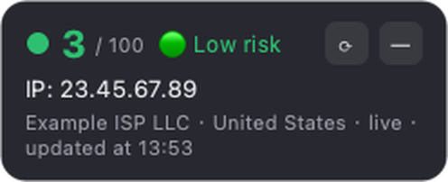
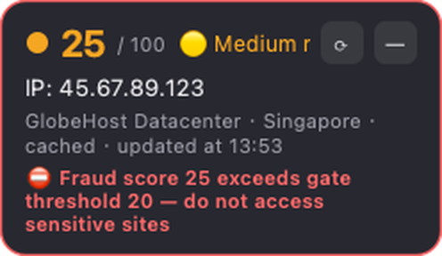
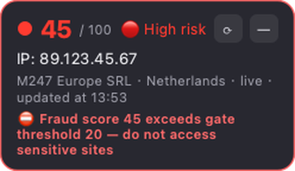

# IPGuard (ip-fraud-guard)

A lightweight always-on desktop widget for macOS / Windows that monitors the
external IP of your current proxy node, scrapes the
[Scamalytics](https://scamalytics.com) fraud score for it, and gates access to
sensitive sites (e.g. Claude) via **widget color, desktop notifications, a
command-line tool and a Tampermonkey userscript**.

> 中文说明请见 [README.zh-CN.md](README.zh-CN.md)

## Features

- 🟢🟡🔴 Floating widget and tray icon change color with the fraud score
  (default bands: 0–15 green / 16–30 yellow / >30 red)
- External IP probing with multi-source failover (ipify / icanhazip / ip.sb /
  ifconfig.me / AWS), inherits the system proxy automatically
- **IP change triggers immediate re-evaluation**; score results are cached
  locally (default 30 min) so Scamalytics is not hammered
- Local gate HTTP API (127.0.0.1 only) + `ipguard-gate` CLI + userscript example
- Frameless translucent widget: drag anywhere, double-click to refresh,
  right-click menu, hide to tray; position is remembered
- Tray icon is drawn at runtime — no image assets; idle memory ~40–60 MB
  (vs 150MB+ for Electron)
- **English / Chinese UI**, switchable from the tray or widget menu;
  defaults to the system language

## Screenshots

| Low risk (score 3) | Medium risk (score 25, over gate) | High risk (score 45) |
|---|---|---|
|  |  |  |

Userscript blocking page:


## How it works

```
┌────────────────────────────────────────────────────────────┐
│                      MonitorWorker (background thread)      │
│   every 60s: probe the external IP (through system proxy)   │
│        │ IP changed ──> scrape fraud score immediately      │
│        │ IP unchanged ──> serve cache (no network in TTL)   │
└────────┼───────────────────────────────────────────────────┘
         │ IpReport
         ▼
┌────────────────────────────────────────────────────────────┐
│  Controller: updates widget / tray color / notifications     │
│        └─> local gate service http://127.0.0.1:17654/status │
│                │                                            │
│                ├─> userscript: checks before sensitive sites │
│                └─> CLI: ipguard-gate && open "https://..."   │
└────────────────────────────────────────────────────────────┘
```

## Project layout

```
ip-fraud-guard/
├── main.py                     # entry point: python main.py
├── requirements.txt
├── ipguard/
│   ├── app.py                  # QApplication + Controller (wiring/lifecycle)
│   ├── config.py               # config load/save (JSON)
│   ├── models.py               # IpReport / RiskLevel / helpers
│   ├── i18n.py                 # minimal en/zh UI strings, runtime switching
│   ├── ipprobe.py              # external IP probing (multi-source, system proxy)
│   ├── scamalytics.py          # Scamalytics scrape + parse + disk cache
│   ├── monitor.py              # background monitor thread (queue polling)
│   ├── resume.py               # sleep/wake detection (QTimer wall-clock gap)
│   ├── floatwidget.py          # frameless translucent widget (draggable)
│   ├── trayicon.py             # system tray icon + menu
│   ├── icons.py                # runtime-drawn colored status icons
│   ├── notifier.py             # notification policy (deduplicated alerts)
│   ├── gate_server.py          # local HTTP gate API (127.0.0.1)
│   └── gate_cli.py             # CLI gate (works without the GUI)
├── scripts/
│   ├── ipguard-gate            # CLI wrapper (macOS/Linux)
│   ├── ipguard-gate.cmd        # CLI wrapper (Windows)
│   └── tampermonkey_gate.user.js  # userscript example
├── tests/                      # unit tests (parser / bands / cache / i18n / resume)
├── packaging/                  # build scripts, icon generator, launchd plist
├── README.md                   # this file (English)
└── README.zh-CN.md             # Chinese
```

## Quick start

Requires Python >= 3.10.

```bash
# macOS / Linux
python3 -m venv .venv
source .venv/bin/activate
pip install -r requirements.txt
python main.py
```

```bat
:: Windows
py -3 -m venv .venv
.venv\Scripts\activate
pip install -r requirements.txt
python main.py
```

The widget appears at the bottom-right corner and a colored dot appears in the
menu bar / tray. Left-drag to move, double-click to force refresh, right-click
for the menu, `—` hides to tray.

## Configuration

Config location (auto-created with defaults on first run):

- macOS: `~/Library/Application Support/IPGuard/config.json`
- Windows: `%APPDATA%\IPGuard\config.json`
- Linux: `~/.config/IPGuard/config.json` (or `$XDG_CONFIG_HOME/IPGuard/config.json`)

```json
{
  "ip_check_interval": 60,        // external IP probe interval (seconds)
  "score_cache_ttl": 1800,        // fraud score cache TTL per IP (seconds)
  "low_max": 15,                  // score <= 15: green (low risk)
  "medium_max": 30,               // 16–30: yellow (medium), >30: red (high)
  "gate_threshold": 20,           // score > 20: gate blocks + strong warning
  "language": "system",           // UI language: "system" | "en" | "zh"
  "notify_on_level_up": true,     // notify on risk escalation
  "notify_on_ip_change": true,    // notify when the proxy node changes
  "notify_on_danger": true,       // warn when the gate threshold is exceeded
  "gate_server": {
    "enabled": true,
    "host": "127.0.0.1",
    "port": 17654,
    "token": ""                   // empty = no auth; otherwise X-Gate-Token header / ?token=
  },
  "request": { "timeout": 10.0, "user_agent": "..." },
  "ui": {
    "always_on_top": true,
    "opacity": 0.96,
    "start_hidden": false,        // true = start in tray only
    "pos_x": null, "pos_y": null  // widget position (remembered automatically)
  }
}
```

## The security gate, three ways

### 1. Desktop notifications (automatic)

Risk escalation (green→yellow→red), proxy node changes, and scores above
`gate_threshold` trigger system notifications; the widget also shows a red
warning bar and red border.

### 2. Command line (scripts / shortcuts)

```bash
# macOS/Linux (exit codes: 0=allowed 1=blocked 2=unknown)
scripts/ipguard-gate && open -a "Safari" "https://claude.ai" || echo "blocked"

# or directly
python -m ipguard.gate_cli --max 20 --json
```

The CLI also works without the GUI running: it probes and scrapes
independently, reusing the same on-disk cache.

### 3. Tampermonkey userscript + local HTTP API

1. Install Tampermonkey and import `scripts/tampermonkey_gate.user.js`;
   adjust the `@match` domains to taste.
2. While IPGuard is running (gate service enabled), visits to matched domains
   query the local service first:
   - score <= threshold: allowed;
   - above threshold: page rendering is blocked with a warning page
     (manual override available);
   - service down: allowed by default (`FAIL_OPEN` in the script can switch
     to fail-closed).

API response example:

```json
{
  "ok": true, "allowed": false, "blocked_reason": "score_exceeds_threshold",
  "ip": "1.2.3.4", "score": 45, "threshold": 20,
  "risk": "high", "risk_label": "High risk", "fetched_at": "..."
}
```

> ⚠️ **Soft gate**: the userscript can only block page rendering; the HTTP
> request has already been sent by the browser. Request-level hard blocking
> requires a local proxy filter (idea: a local HTTP proxy that consults the
> gate API per domain before allowing the request, or a PAC file). Happy to
> add it as a follow-up.

## Packaging as a native app

### macOS

```bash
bash packaging/build_macos.sh
# output: dist/IPGuard.app (menu-bar-only app, no Dock icon)
cp -r dist/IPGuard.app /Applications/
```

- Ad-hoc signed for personal use;
- if Gatekeeper blocks the first launch: `xattr -cr /Applications/IPGuard.app`;
- distribution to others requires Developer ID signing + notarization;
- autostart: System Settings → General → Login Items, or use
  `packaging/com.ipguard.plist` (LaunchAgent).

### Windows

```bat
packaging\build_windows.bat
:: output: dist\IPGuard.exe (single file)
```

Unsigned binaries may trigger SmartScreen on first run — choose
"More info → Run anyway".

## Tests

```bash
python -m unittest discover -s tests -v
```

Covers: page parsing (fixture mirrors the live page structure), embedded-JSON
fallback, risk band boundaries, IP validation, cache round-trip and corruption
tolerance, i18n switching.

## Design notes

- **Why not refresh the score every 60s**: Scamalytics scores are not
  second-level data — the same IP's score does not change within minutes.
  The IP probe stays at 60s (lightweight); the score result is cached for
  30 min and re-scraped immediately when the IP changes. Double-click the
  widget for a manual force refresh.
- **Time display**: the widget shows the data's actual scrape time in local
  time ("updated at HH:MM") — with a "cached" badge when the value comes
  from the cache. The gate API's `fetched_at` is ISO-8601 UTC.
- **Proxy support**: requests inherits the system proxy. Clash-style system
  proxy mode and TUN mode both work; SOCKS5 needs PySocks (included).
- **Scamalytics etiquette**: this project queries only the user's own IP at
  low frequency. Do not lower the cache TTL or batch-scan; for bulk queries
  use their official paid API (the JSON on the page is its preview).
- **macOS notification name**: running via `python main.py` shows "Python" as
  the notification sender; the PyInstaller bundle shows "IPGuard".
- **Port conflicts**: if 17654 is taken, the gate service disables itself and
  logs a warning; change `gate_server.port` if needed.

## FAQ

- **Widget doesn't show on top?** Fullscreen apps cover normal top-level
  windows — that's system behavior. If the widget opens behind other windows,
  toggle "always on top" off and on from the menu (this re-applies the macOS
  window flag).
- **Scamalytics unreachable / timeout?** The widget shows the last cached
  result ("stale cache"), or gray "unknown" if there was never a success.
  Confirm your system proxy works; some networks require a proxy to reach
  scamalytics.com.
- **CLI only, no GUI?** `python -m ipguard.gate_cli` works standalone.
- **Tray click does nothing?** On macOS, with a context menu set, clicking the
  tray icon opens the menu directly — use "Show/Hide widget".
- **Tray icon missing on a notched MacBook?** The icon still exists: when the
  menu bar is full, macOS pushes the leftmost (newest) items under the notch,
  where they are invisible and unclickable. Free ~40 px (e.g. hide the
  Spotlight or input-source menu bar item) and the dot slides out; then
  ⌘-drag it to the right of the notch so it keeps priority.
- **Widget gone after closing the lid?** Fixed in 0.2.1: the floating window
  is re-shown automatically after system sleep. On 0.2.0 and older, relaunch
  IPGuard or use the tray menu to show it again.

## Disclaimer

Fraud score data comes from Scamalytics' public pages for personal reference
only and is not a security guarantee. This project is not affiliated with
Scamalytics; respect their terms of service and keep request rates low.

## License

[MIT](LICENSE) — feel free to use, modify and redistribute (including
commercially), provided the copyright notice is retained.
