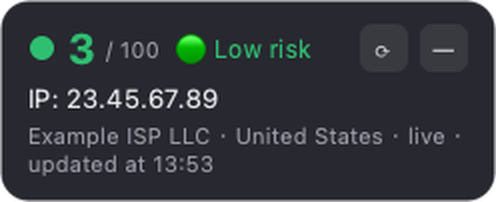
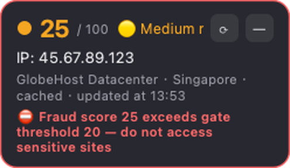
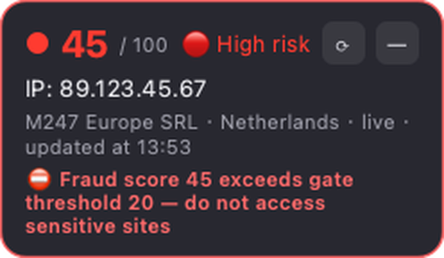

# IPGuard（ip-fraud-guard）

常驻 macOS / Windows 的轻量悬浮窗应用：实时监控当前代理节点的外网 IP，抓取
[Scamalytics](https://scamalytics.com) 欺诈分（Fraud Score），超过阈值时通过
**悬浮窗变色、桌面通知、命令行、油猴脚本**四种方式提供访问安全门控。

> English version: [README.md](README.md)

## 特性

- 🟢🟡🔴 悬浮窗 / 托盘图标随欺诈分自动变色（默认：0–15 绿 / 16–30 黄 / >30 红）
- 外网 IP 多源探测（ipify / icanhazip / ip.sb / ifconfig.me / AWS），自动继承系统代理
- **IP 变化立即重新评估**；欺诈分结果本地缓存（默认 30 分钟），不向 Scamalytics 发起高频请求
- 本地门控 HTTP API（仅 127.0.0.1）+ 命令行 `ipguard-gate` + 油猴脚本示例
- 无边框半透明悬浮窗：任意拖拽、双击刷新、右键菜单，可隐藏到系统托盘
- 托盘图标运行时绘制，无需图片资源；空闲内存约 40–60 MB（远低于 Electron 的 150MB+）
- **界面中英文切换**：托盘或悬浮窗菜单里选择语言，默认跟随系统语言

## 截图

| 低风险（3 分） | 中风险（25 分，超过门控） | 高风险（45 分） |
|---|---|---|
|  |  |  |

油猴脚本拦截页：


## 工作原理

```
┌────────────────────────────────────────────────────────────┐
│                      MonitorWorker（后台线程）                │
│   每 60s：探测外网 IP（经系统代理 → 代理出口 IP）               │
│        │ IP 变化 ──→ 立即抓取欺诈分（绕过缓存）                  │
│        │ IP 不变 ──→ 命中缓存直接返回（30 分钟内零网络请求）      │
└────────┼───────────────────────────────────────────────────┘
         │ IpReport
         ▼
┌────────────────────────────────────────────────────────────┐
│  Controller：更新悬浮窗 / 托盘图标颜色 / 桌面通知               │
│        └─→ 本地门控服务 http://127.0.0.1:17654/status       │
│                │                                           │
│                ├─→ 油猴脚本：敏感域名访问前查询，超阈值拦截页面    │
│                └─→ 命令行：ipguard-gate && open "https://..." │
└────────────────────────────────────────────────────────────┘
```

## 目录结构

```
ip-fraud-guard/
├── main.py                     # 入口：python main.py
├── requirements.txt
├── ipguard/
│   ├── app.py                  # QApplication + Controller（信号接线/生命周期）
│   ├── config.py               # 配置加载/持久化（JSON）
│   ├── models.py               # IpReport / RiskLevel / 工具函数
│   ├── i18n.py                 # 极简中英文文案，运行时切换语言
│   ├── ipprobe.py              # 外网 IP 多源探测（继承系统代理）
│   ├── scamalytics.py          # Scamalytics 抓取 + 解析 + 磁盘缓存
│   ├── monitor.py              # 后台监控线程（队列轮询，无忙等）
│   ├── resume.py               # 睡眠/唤醒检测（QTimer 墙钟跳变）
│   ├── floatwidget.py          # 无边框半透明悬浮窗（可拖拽）
│   ├── trayicon.py             # 系统托盘图标 + 菜单
│   ├── icons.py                # 运行时绘制彩色状态图标
│   ├── notifier.py             # 通知策略（升级/IP变化/门控告警，去重）
│   ├── gate_server.py          # 本地 HTTP 门控 API（127.0.0.1）
│   └── gate_cli.py             # 命令行门控（可脱离 GUI 独立使用）
├── scripts/
│   ├── ipguard-gate            # CLI 封装（macOS/Linux）
│   ├── ipguard-gate.cmd        # CLI 封装（Windows）
│   └── tampermonkey_gate.user.js  # 油猴脚本示例
├── tests/                      # 单元测试（解析器/分级/缓存/i18n/唤醒检测）
├── packaging/                  # 打包脚本、图标生成、开机自启 plist
├── README.md                   # 英文说明
└── README.zh-CN.md             # 本文件（中文）
```

## 快速开始

要求 Python >= 3.10。

```bash
# macOS / Linux
python3 -m venv .venv
source .venv/bin/activate
pip install -r requirements.txt
python main.py
```

```bat
:: Windows
py -3 -m venv .venv
.venv\Scripts\activate
pip install -r requirements.txt
python main.py
```

启动后：悬浮窗出现在屏幕右下角，菜单栏/托盘出现彩色圆点图标。
左键拖动悬浮窗，双击立即刷新，右键弹出菜单；点 `—` 隐藏到托盘。

## 配置

配置文件位置（首次运行自动生成默认配置）：

- macOS：`~/Library/Application Support/IPGuard/config.json`
- Windows：`%APPDATA%\IPGuard\config.json`
- Linux：`~/.config/IPGuard/config.json`（或 `$XDG_CONFIG_HOME/IPGuard/config.json`）

```json
{
  "ip_check_interval": 60,        // 外网 IP 探测间隔（秒）
  "score_cache_ttl": 1800,        // 同一 IP 欺诈分缓存时长（秒）
  "low_max": 15,                  // 分数 <= 15：绿色（低风险）
  "medium_max": 30,               // 16–30：黄色（中风险），>30：红色（高风险）
  "gate_threshold": 20,           // 分数 > 20：门控拦截 + 强力警告
  "language": "system",           // 界面语言："system"（跟随系统）| "en" | "zh"
  "notify_on_level_up": true,     // 风险升级时通知
  "notify_on_ip_change": true,    // 代理节点切换时通知
  "notify_on_danger": true,       // 超过门控阈值时警告
  "gate_server": {
    "enabled": true,
    "host": "127.0.0.1",
    "port": 17654,
    "token": ""                   // 留空无需鉴权；填写后请求需带 X-Gate-Token 头
  },
  "request": { "timeout": 10.0, "user_agent": "..." },
  "ui": {
    "always_on_top": true,
    "opacity": 0.96,
    "start_hidden": false,        // true = 启动只进托盘不显示悬浮窗
    "pos_x": null, "pos_y": null  // 悬浮窗位置（自动记忆）
  }
}
```

## 安全门控的三种用法

### 1. 桌面通知（自动）

风险升级（绿→黄→红）、代理节点切换、欺诈分超过 `gate_threshold` 时自动弹出系统通知，
悬浮窗同时出现红色警示条并变为红框。

### 2. 命令行（脚本 / 快捷方式）

```bash
# macOS/Linux（退出码：0=允许 1=拦截 2=未知）
scripts/ipguard-gate && open -a "Safari" "https://claude.ai" || echo "已拦截"

# 也可以直接
python -m ipguard.gate_cli --max 20 --json
```

GUI 未运行时 CLI 也能独立工作（自己探测 IP + 抓取，复用同一份磁盘缓存）。

### 3. 油猴脚本 + 本地 HTTP API

1. 安装 Tampermonkey，导入 `scripts/tampermonkey_gate.user.js`，按需增删 `@match` 域名；
2. IPGuard 运行中（门控服务开启）时，访问匹配域名会先查询本地服务：
   - 欺诈分 ≤ 阈值：正常放行；
   - 超阈值：拦截页面渲染，显示警告页（可手动继续）；
   - 服务未运行：默认放行（脚本里 `FAIL_OPEN` 可改为故障即拦截）。

API 返回示例：

```json
{
  "ok": true, "allowed": false, "blocked_reason": "score_exceeds_threshold",
  "ip": "1.2.3.4", "score": 45, "threshold": 20,
  "risk": "high", "risk_label": "High risk", "fetched_at": "..."
}
```

> ⚠️ **软门控说明**：油猴脚本只能阻止页面渲染，HTTP 请求在浏览器层面已经发出。
> 如需请求级硬拦截，需要本地代理过滤层（思路：本地 HTTP 代理按域名检查门控 API 后
> 决定放行/拒绝，或维护 PAC 文件）。欢迎作为后续增强。

## 打包为可执行 App

### macOS

```bash
bash packaging/build_macos.sh
# 产物：dist/IPGuard.app（纯菜单栏应用，无 Dock 图标）
cp -r dist/IPGuard.app /Applications/
```

- 已做本地自签名（ad-hoc），个人使用可直接运行；
- 首次运行若被 Gatekeeper 拦截：`xattr -cr /Applications/IPGuard.app`；
- 分发给他人需 Developer ID 签名 + 公证（notarization）；
- 开机自启：系统设置 → 通用 → 登录项 添加 IPGuard.app，或用 `packaging/com.ipguard.plist`（LaunchAgent）。

### Windows

```bat
packaging\build_windows.bat
:: 产物：dist\IPGuard.exe（单文件）
```

未签名程序首次运行可能触发 SmartScreen，点"更多信息 → 仍要运行"。

## 测试

```bash
python -m unittest discover -s tests -v
```

测试覆盖：页面解析（基于真实页面结构的 fixture）、JSON 降级解析、风险分级边界、
IP 校验、缓存读写与损坏容错、中英文切换。

## 设计说明

- **为什么不每 60 秒刷新欺诈分**：Scamalytics 的分数不是秒级数据，同一 IP 的分数在
  短时间不会变化；高频抓取既无价值，也容易被风控。因此 IP 探测保持 60s（轻量），
  欺诈分结果缓存 30 分钟，IP 变化时立即重新抓取。需要时双击悬浮窗可强制刷新。
- **时间显示**：悬浮窗显示数据的**实际抓取时间**（本地时区，"更新于 HH:MM"），
  来自缓存时会带"缓存"标记；门控 API 的 `fetched_at` 是 ISO-8601 UTC 时间。
- **代理支持**：requests 自动继承系统代理设置。Clash/代理工具的系统代理模式、
  TUN 模式均可正常工作；SOCKS5 代理依赖 PySocks（已内置）。
- **Scamalytics 使用礼仪**：本项目仅低频查询自身 IP 的公开页面，请勿调低缓存 TTL
  或高频调用；批量查询请考虑其官方付费 API（页面内嵌 JSON 即其 API 预览）。
- **macOS 通知名称**：直接 `python main.py` 运行时通知显示为 "Python"，
  PyInstaller 打包后正常显示 "IPGuard"。
- **端口冲突**：17654 被占用时门控服务自动停用并在日志告警，可改 `gate_server.port`。

## FAQ

- **悬浮窗没显示在最前？** 全屏应用会覆盖普通置顶窗口，这是系统行为。
  如果窗口被压在别的窗口后面，在菜单里把"悬浮窗置顶"关掉再打开（会重新应用
  macOS 窗口标志）。
- **Scamalytics 打不开/超时？** 显示"过期缓存"+ 上次结果；若从未成功过会显示灰色。
  确认系统代理工作正常；部分网络环境需要代理才能访问 scamalytics.com。
- **只想用命令行门控，不想挂 GUI？** `python -m ipguard.gate_cli` 可完全独立使用。
- **托盘点击没反应？** macOS 上设置上下文菜单后左键直接弹菜单，用菜单里的
  "显示/隐藏悬浮窗"即可。
- **刘海屏 MacBook 上菜单栏图标不见了？** 图标其实还在：菜单栏图标太多时，
  macOS 会把最左侧（最新加入）的图标挤到刘海下面，既看不见也点不到。
  腾出约 40px（例如隐藏「聚焦」或输入法菜单栏图标）后圆点会露出来；
  随后按住 ⌘ 把它拖到刘海右侧，避免以后再被挤进去。
- **合盖后悬浮窗不见了？** 0.2.1 已修复：系统睡眠唤醒后会自动重新显示悬浮窗。
  0.2.0 及更早版本需要重启 IPGuard，或用托盘菜单重新显示。

## 免责声明

欺诈分数据来自 Scamalytics 公开页面，仅供个人参考，不构成任何安全保证；
本项目与其无任何关联。请遵守 Scamalytics 服务条款，控制查询频率。

## 许可证

[MIT](LICENSE) — 可自由使用、修改、再分发（含商用），仅需保留版权声明。
